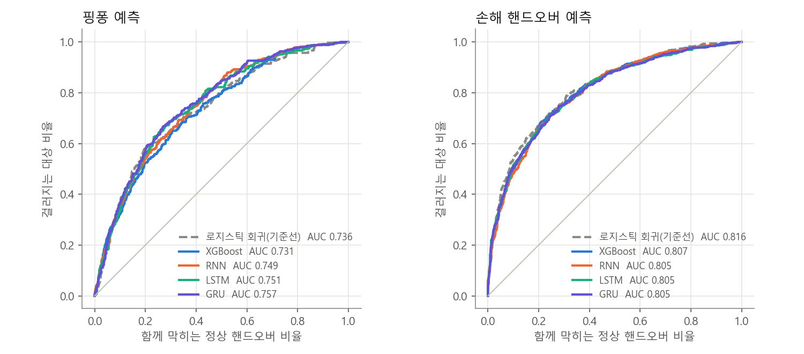
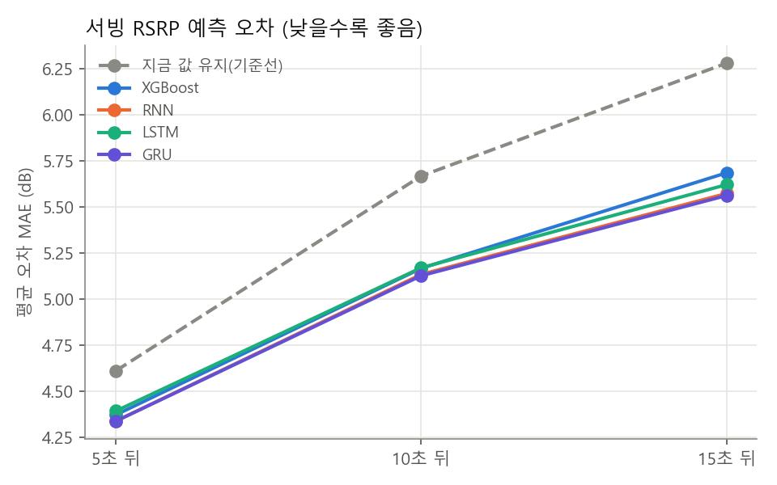
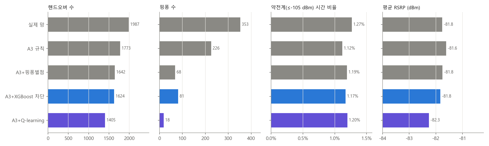
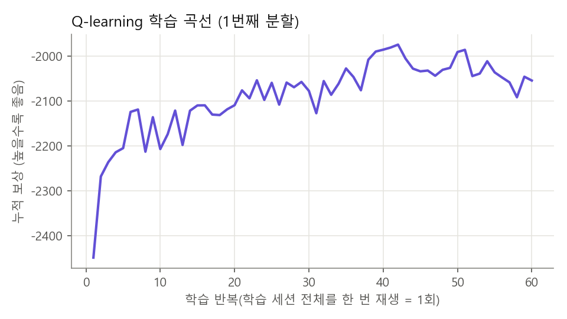

# 핸드오버 AI 모델 비교 보고

보고일: 2026년 10월 28일
근거 데이터: trackingcsv/new 31개 세션, 핸드오버 1,987건 (2026-08-04 ~ 2026-10-25)
관련 코드: analysis/model_compare.py (실험), analysis/model_compare_fig.py (그림)
관련 문서: 핸드오버_AI_연구방향.md, 핸드오버_데이터_점검_보고.md

**요약**

- 교수님 todo 1·3·4번 진행함. 2번(Jev)은 유료 API라 이번엔 비워둠 -> 다음 달 결제 후 같은 데이터로 추가 예정
- 모델 4종(XGBoost, RNN/LSTM, GRU, Q-learning) 같은 데이터·같은 분할로 비교했음
- 핑퐁 예측: GRU AUC 0.757로 제일 높았음 (기준선 로지스틱 회귀 0.736). 다만 차이 작음 -> 데이터 양이 더 필요
- 신호 예측: 모든 모델이 "지금 값 유지"보다 나았음. 10초 뒤 오차 5.67 -> 5.12 dB (GRU, 약 10% 개선)
- 핸드오버 정책: Q-learning이 핸드오버 −29%, 핑퐁 −95%. 약전계 비율은 오히려 줄었고(1.27% -> 1.20%) 평균 RSRP 손해 0.5 dB -> 연구방향 문서의 성공 기준 거의 충족
- SINR 빈칸: 원인은 앱이 아니라 모뎀이 셀 정보 갱신을 늦추는 상태. v1.4 앱으로 1초마다 요청해도 그 상태가 되면 같이 빠짐

---

**0. 공통 실험 방법**

- 세션 단위 5겹 교차검증 -> 같은 세션이 학습·평가에 섞이지 않게 함
- 신경망(RNN, LSTM, GRU)은 시드 3개 돌려서 평균냄 (학습 세션 일부를 떼어 조기 종료)
- 입력 두 종류
  - 표 특징 15개: 직전·직후 RSRP/RSRQ, 직전 셀 체류 시간, 최근 30초 HO 수, 같은 기지국 여부, 주파수 변경 여부, 이번 HO가 복귀인지, 직전 이웃 목록에서 목표 셀 순위·여유, 이동수단 (기존 pp_feasibility.py와 같음)
  - 시계열: 직전 12행(약 60초)의 RSRP, RSRQ, 최강 이웃과의 차, 이웃 수, HO·핑퐁 여부, 수집 간격, 셀 정보 동결 여부
- XGBoost는 시계열 마지막 6행을 펼쳐서 표 특징과 붙여 넣음. 표 특징 15개만 넣은 버전도 같이 돌림

---

**1. 핑퐁·손해 핸드오버 예측 (분류)**

- 핑퐁: 핸드오버 A->B 후 30초 안에 다시 A로 돌아오면 1 (1,987건 중 326건, 16.4%)
- 손해 핸드오버: 핸드오버 10초 뒤 RSRP가 직전보다 3 dB 이상 낮으면 1 (1,928건 중 676건, 35.1%)

| 모델 | 핑퐁 AUC | 핑퐁 AP | 보정 오차(ECE) | 손해 HO AUC |
|---|---|---|---|---|
| 로지스틱 회귀 (기준선) | 0.736 | 0.333 | 0.013 | **0.816** |
| XGBoost (표 특징만) | 0.731 | 0.346 | 0.028 | 0.807 |
| XGBoost (표 + 시계열) | 0.710 | 0.317 | 0.038 | 0.800 |
| RNN | 0.749 | 0.359 | 0.016 | 0.805 |
| LSTM | 0.751 | 0.351 | **0.007** | 0.805 |
| GRU | **0.757** | **0.360** | 0.011 | 0.805 |

- 핑퐁은 시계열 모델(GRU > LSTM > RNN)이 기준선보다 조금 나았음. 시드별 편차(±0.007~0.015)를 생각하면 차이가 크지는 않음
- XGBoost는 기준선보다 낮았음. 시계열을 펼쳐 넣으면 특징이 69개로 늘어나 과적합 -> 표본 2천 건 규모에선 트리 모델 장점이 안 나옴
- 실제로 쓰는 기준: 점수 상위 20%를 막으면 핑퐁 45~48% 걸러지고 정상 HO 15% 같이 막힘 -> 모델 간 차이 거의 없음
- 중요 특징 1위는 여전히 "이번 HO가 이미 복귀인가"(핑퐁이 연쇄로 일어남). 그다음이 직전 행 HO 여부, 셀 정보 동결 여부, 목표 셀이 직전 이웃 목록에 있었는지
- 손해 HO는 모든 모델이 AUC 0.80 이상이었는데, 직후 RSRP가 이미 입력에 들어가 있어서 쉬운 문제임 -> 선형으로 충분, 복잡한 모델 이득 없음
- (보정 오차는 Jev 비교용으로 미리 넣어둠. Jev는 "확률이 잘 맞는 것"이 강점이라 AUC와 같이 봐야 함)

---

**2. 서빙 RSRP 단기 예측 (회귀)**

- 신선한 행 10,187개에서 직전 60초를 보고 5·10·15초 뒤 서빙 RSRP 변화량 예측
- 기준선은 "지금 값 그대로 유지"

| 모델 | 5초 뒤 | 10초 뒤 | 15초 뒤 |
|---|---|---|---|
| 지금 값 유지 (기준선) | 4.61 | 5.67 | 6.28 |
| XGBoost | 4.37 | 5.17 | 5.68 |
| RNN | 4.34 | 5.13 | 5.57 |
| LSTM | 4.39 | 5.17 | 5.62 |
| GRU | **4.34** | **5.12** | **5.56** |

(평균 오차 MAE, dB)

- 모든 모델이 기준선보다 나았고 멀리 볼수록 차이 커짐 (15초 뒤 6.28 -> 5.56 dB, 11% 개선)
- 모델끼리 차이는 0.1 dB 안쪽 -> 어떤 모델이냐보다 입력 정보가 한계
- 이동수단별로 지하철 오차가 제일 큼 (10초 뒤 GRU 7.1 dB, 차량 4.6, 도보 4.1). 지하철은 역·터널 전환이 급해서 그런 듯
- 지하철은 모델 이득도 제일 큼 (기준선 8.2 -> 7.1 dB). 차량·도보 5초 뒤는 기준선과 거의 비슷함

---

**3. 핸드오버 정책 비교 (재생 시뮬레이터)**

- 측정된 서빙·이웃 RSRP를 시간순으로 다시 돌리면서 "같은 주파수 이웃이 3 dB 세진 순간"마다 옮길지/보류할지 결정
- 비교한 정책
  - 실제 망: 측정된 그대로
  - A3 규칙: 3 dB 세면 무조건 옮김
  - A3 + 핑퐁벌점: 30초 안에 떠난 셀로 돌아가려면 6 dB 더 세야 함 (지난번 규칙 실험 최고안)
  - A3 + XGBoost 차단: 1번 분류 모델 점수가 상위 20%면 보류. 재생 중에도 계산되는 특징 9개로 다시 학습
  - A3 + Q-learning: 상태(서빙 RSRP 4구간 × 이웃과의 차 3구간 × 복귀 여부 × 직전 HO 후 경과 3구간 = 72개)마다 옮김/보류 학습
- Q-learning 보상(약 5초 행마다): 핸드오버 −1, 핑퐁 −3, 약전계(≤−105 dBm) −5, 같은 주파수 최강 셀 대비 손해 dB × −0.1
- Q-learning과 XGBoost 차단은 학습 세션으로 학습 -> 남은 세션에서 평가 (5겹, 평가 세션 합계)

| 정책 | 핸드오버 | 핑퐁 | 약전계 비율 | 평균 RSRP | 최강 셀 대비 |
|---|---|---|---|---|---|
| 실제 망 | 1,987 | 353 | 1.27% | −81.8 | 0.15 dB |
| A3 규칙 | 1,773 (−11%) | 226 (−36%) | 1.12% | −81.6 | 0.08 dB |
| A3 + 핑퐁벌점 | 1,642 (−17%) | 68 (−81%) | 1.19% | −81.8 | 0.22 dB |
| A3 + XGBoost 차단 | 1,624 (−18%) | 81 (−77%) | 1.17% | −81.8 | 0.31 dB |
| **A3 + Q-learning** | **1,405 (−29%)** | **18 (−95%)** | 1.20% | −82.3 | 0.71 dB |

- Q-learning이 핸드오버·핑퐁 모두 제일 많이 줄였음. 약전계 비율은 실제 망보다 낮고 평균 RSRP 손해 0.5 dB -> 연구방향 문서 성공 기준(HO −30%, 핑퐁 −80%, 약전계 증가 없음, RSRP 손실 1 dB 이내)에 거의 맞음
- 학습된 표(1번째 분할)를 보면 결정 기준이 사람이 정한 규칙과 비슷했음
  - 복귀 핸드오버(핑퐁 후보)는 서빙이 −105 dBm보다 세면 전부 보류, 약전계일 때만 일부 허용
  - 복귀가 아닌 핸드오버는 이웃이 3~6 dB만 세면 대체로 보류, 6 dB 넘게 세면 옮김
  - 즉 "애매하게 센 이웃으로는 안 옮김" -> 1~4번 점검 결론("신호 좋을 때 HO는 손해")과 같은 방향
- XGBoost 차단은 핑퐁벌점 규칙과 거의 같은 성능 -> 분류 점수만으로 막는 것보다 상황별로 학습하는 쪽이 나았음
- 학습 곡선은 40회쯤 수렴. 이후 흔들림은 탐색(ε) 때문

**한계**

- 강제 이동: 가상 셀이 이웃 목록에서 사라지면 실제 망이 고른 셀로 강제로 옮김 (Q-learning 378건). 보류를 많이 할수록 늘어나서 HO 감소폭이 실제보다 작게 나왔을 수도, 크게 나왔을 수도 있음 -> v1.4 데이터(셀 정보 1초 갱신)가 쌓이면 다시 보기
- 재생은 망이 우리 결정에 어떻게 반응할지(셀 부하 등)는 반영 못 함
- 보상 가중치는 손으로 정함. 가중치에 따라 결과 바뀜 -> 몇 가지 조합 더 돌려볼 필요
- Q-learning은 상태를 72개로 쪼갠 표 방식이라 GRU 신호 예측 같은 연속값은 아직 못 넣음 -> 다음 단계에서 예측값을 상태에 넣는 방식 고민필요

---

**4. Jev 적용 가능성 (todo 2번)**

- Jev: TypeSafe AI가 2026-09-15 공개한 모델. 대화형이 아니라 "예/아니오 확률, 보기 선택, 점수"를 내는 판단 전용 모델
- 확률이 실제 맞을 확률과 맞도록(보정) 학습했다는 게 핵심 -> 우리 문제("이 HO가 핑퐁일 확률")와 형태가 그대로 맞음
- 회사 발표로는 기존 모델보다 최대 444배 싸고 193배 빠름 (독립 검증은 아직 못 찾음)
- 유료 API라 이번엔 미적용 -> 다음 달 결제 후 추가 예정
- 추가할 때 방법
  - 1번과 같은 표 특징을 넣고 핑퐁 확률 받기 (위치 정보는 빼고 신호 수치만 보냄)
  - 같은 세션 분할로 AUC·보정 오차 비교, 학습 없이 바로 쓰는 경우와 예시 몇 개 넣는 경우 둘 다
  - 3번 재생 시뮬레이터에 "Jev 차단" 정책으로도 넣어보기

---

**5. SINR 빈칸 다시 보기 (todo 4번)**

- 세션별 빈칸 비율이 0%부터 98%까지 나뉨. v1.4 앱으로 측정한 10/16·10/25 세션은 0%, 0%, 14%
- v1.4는 셀 정보를 1초마다 요청함 -> 셀 정보 나이 중앙값이 2.9~5초에서 약 1초로 줄었음
- 그래도 10/25 세션에서 빈칸 생긴 구간은 셀 정보 나이 중앙값이 4.0초 (정상 구간 0.95초) -> 1초마다 요청해도 모뎀이 응답을 늦게 주는 상태가 있고 그때 SINR이 같이 빠짐
- 전체 세션에서도 셀 정보가 8초 넘게 묵은 행은 SINR 빈칸이 대부분 세션에서 85~99%, 신선한(3초 이내) 행은 대부분 세션에서 0~5%
- 앱 코드 확인: SINR을 셀 정보(CellInfo)의 rssnr에서만 읽고 있음 -> 셀 정보가 늦게 오면 SINR도 같이 늦거나 빠짐
- 결론: 앱 버그가 아니라 단말 모뎀의 보고 주기 문제 (저전력 상태로 추정, 기존 결론과 같음)
- 5G CSI-SINR은 전 세션 0% -> 5G 셀 자체가 한 번도 안 잡혀서 (NR_NSA 표시만 있고 5G 셀 정보 없음)
- 다음에 해볼 것
  - 앱에서 SINR을 다른 경로(SignalStrength 콜백)로도 같이 받아보기 -> 셀 정보가 늦을 때도 SINR이 오는지 확인
  - 화면 켜짐/꺼짐 상태 기록 추가 -> 저전력 상태 추정 확인

---

**6. 다음 할 일**

- Jev 추가 (다음 달)
- v1.4 앱으로 지하철·차량 데이터 더 모으기 -> 핑퐁 표본이 늘면 GRU·LSTM 차이가 더 분명해질지 확인
- Q-learning 보상 가중치 바꿔가며 결과 표 만들기
- GRU 신호 예측값을 Q-learning 상태에 넣어보기 (예측 기반 정책)
